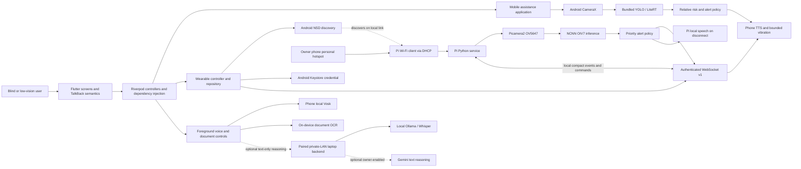
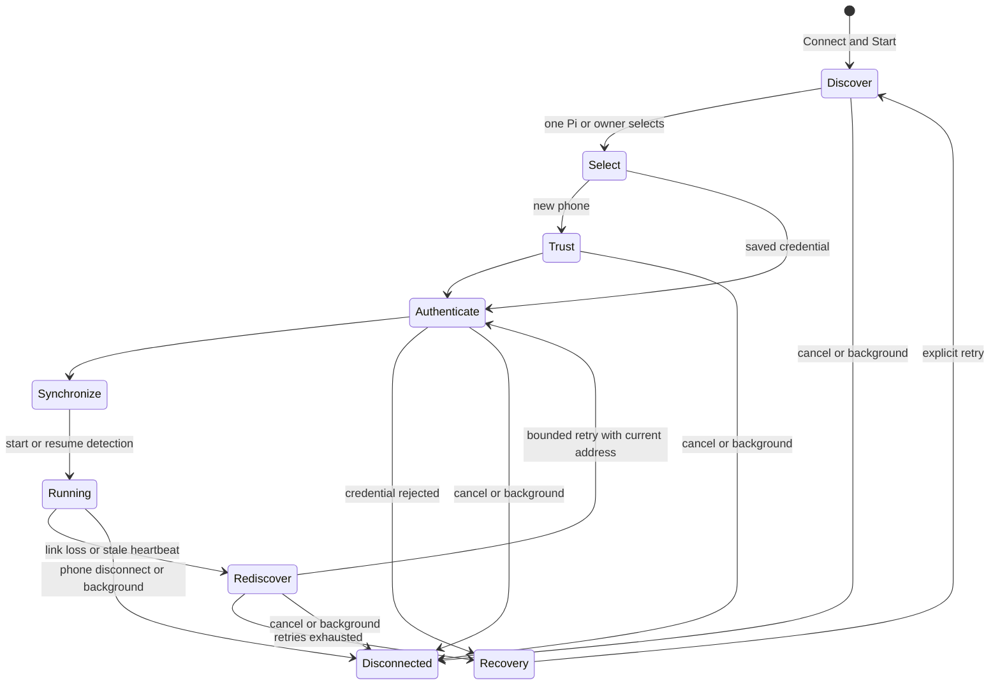

# Project graph

Last reviewed: 2026-09-28

This Mermaid graph maps the implemented components. It is a source graph, not
evidence that the Raspberry Pi and phone have connected physically.



## Phone-hotspot connection sequence

```mermaid
sequenceDiagram
  actor Owner
  participant Phone as Android phone
  participant Pi as Raspberry Pi
  participant App as Flutter wearable module
  Owner->>Phone: Enable personal hotspot in Android Settings
  Pi->>Phone: Join saved SSID; request DHCP address
  Pi->>Phone: Advertise _aiba-wearable._tcp via mDNS
  Owner->>App: Connect and Start (or Search local network)
  App->>Phone: Bounded Android NSD discovery
  Phone-->>App: Pi service and current address, if multicast works
  alt NSD unavailable on this phone
    Owner->>App: Enter verified current Pi address or hostname
  end
  App->>Pi: Connect to private address:8765
  Pi-->>App: Hello and device ID
  App->>Pi: First enrollment or saved-credential authentication
  Pi-->>App: Signed compact alerts
  App-->>Owner: Spoken priority alert
```

## Recovery state graph



Reconnect preserves the Pi-reported assistance state. An idle Pi after reboot
needs Start Detection; a running Pi continues. Disconnected phone state does
not mean a stop command was sent to the Pi. Software operation/session guards
reject late state changes and new phone speech from a disconnected session.

## Current boundaries

- The hotspot replaces dependence on university/public Wi-Fi and keeps the Pi
  with the owner's phone. It does **not** make the Pi's DHCP address static.
- First enrollment is exclusive trust on first use. The phone must verify that
  the discovered Pi is the intended device before enrollment.
- Pi camera frames remain on the Pi. Mobile Mode remains independent.
- The laptop backend is optional and outside the core offline assistance path.
- Physical hotspot discovery, first enrollment, reconnection, Pi camera and
  alert audio are still acceptance gates.
