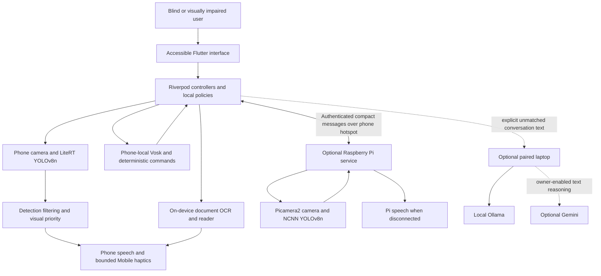

# AI Blind Assistant — Complete Project and Presentation Brief

**22 October 2026 correction:** Use the [complete current project/GPT guide](../deliverables/AI_Blind_Assistant_Complete_GPT_Guide.md) for current provider, device and test evidence. Custom household fine-tuning is not established by the available training/export records and must not be presented as completed work. The wording below is corrected accordingly. This brief's older device/test results remain historical; its original Word export is not regenerated and is superseded for current claims.

**Prepared:** 12 October 2026
**Project type:** Academic Final Year Project (FYP)
**Platform:** Android-first native Flutter application, with optional Raspberry Pi wearable and laptop assistant
**Purpose:** Presentation preparation, technical explanation, demonstration planning and viva preparation

This brief describes the repository as reviewed on its preparation date; the 22 October correction above governs unsupported training claims. Software verification results are dated **9 October 2026**; this documentation review does not represent a new hardware test or accuracy experiment. “Implemented” means the code exists; “physically accepted” requires evidence from the actual devices and users.

## 1. Project in one sentence

**AI Blind Assistant converts camera observations and printed text into accessible spoken information, with optional vibration and voice control, while keeping core assistance offline and processing images locally.**

Suggested presentation title:

> AI Blind Assistant: Offline Object Awareness and Document Reading with Android and an Optional Raspberry Pi Wearable

### 30-second introduction

> Our project supports blind and visually impaired users by identifying relevant objects through a camera and announcing short descriptions such as “Chair on the left” or “Person ahead.” It runs object detection locally on an Android phone, and also supports an optional Raspberry Pi wearable connected through the phone's hotspot. The application includes offline document reading, accessible controls and local voice commands. For household detection, we integrated an Open Images V7 pretrained YOLOv8n model and household-oriented post-processing; custom fine-tuning is not claimed without training evidence. The system is an additional awareness aid alongside established mobility support.

### Presentation abstract

AI Blind Assistant is an Android assistive application designed for blind and visually impaired users. Its primary workflow captures phone-camera frames, performs lightweight local object detection, estimates relative visual priority and presents concise offline speech and bounded vibration feedback. A second workflow uses a Raspberry Pi camera wearable: the Pi performs inference locally and sends compact authenticated detection and feedback messages to the phone through a private hotspot network. Images are not streamed to the phone or uploaded to a cloud service. The application also provides on-device document OCR, an interactive spoken reader, accessible Flutter screens, local settings and foreground voice commands. An optional paired laptop supports general conversation and local personal utilities through Ollama, with owner-enabled Gemini text reasoning and automatic local fallback. Household support uses an Open Images V7 pretrained detector and application-level adaptation; an owner-trained checkpoint is not established. Automated tests and Android builds provide software evidence, while physical wearable, accessibility and sustained-performance acceptance remain open.

## 2. Problem, motivation and intended users

### Problem statement

Visual information about objects and printed documents may be difficult to access without assistance. A useful assistive interface must also be operable without relying on small visual controls, uninterrupted internet connectivity or continuous attention to a screen.

The engineering problem is therefore broader than object classification: capture a usable view, run inference within device limits, decide which result matters, communicate it without overwhelming the user and provide accessible recovery when a component fails.

### Motivation

- Provide useful object and text awareness with local processing.
- Keep the core workflow available without internet access.
- Reduce the need to inspect a screen through speech, haptics and voice commands.
- Offer a phone-only starting point and an optional wearable camera arrangement.
- Avoid uploading camera images or requiring a user account.

### Intended users and situations

The primary users are blind and visually impaired Android users, including people who use TalkBack, large text, high contrast or audio feedback. Example situations include identifying furniture in a room, hearing the relative direction of a detected object and reading a printed page or product label.

These are intended use cases, not evidence of clinical benefit or validated independent navigation. A missing alert never means that a path is clear.

## 3. Objectives and scope

| Objective | Implementation approach | Evidence still needed |
|---|---|---|
| Recognize relevant objects locally | Bundled YOLOv8n detectors on Android; NCNN detector on Pi | Representative scene accuracy and failure analysis |
| Give understandable feedback | Short object/direction speech; finite vibration patterns in Mobile Mode | User comprehension, actual speaker/haptic tests |
| Operate without internet for core tasks | Local models, local OCR, local voice commands and settings | WAN-disabled physical demonstrations |
| Support accessible operation | Native Flutter semantics, TalkBack labels, scalable layouts and voice actions | Screen-by-screen TalkBack and blind-user review |
| Make wearable use straightforward | Phone hotspot, discovery, remembered trust and Connect & Start | Actual phone/Pi discovery, routing and reconnect acceptance |
| Adapt household recognition | Open Images pretrained detection and household post-processing | Controlled evaluation; any future training needs records and deployment provenance |

### Included in the current source

Mobile object awareness; household-oriented detection processing; estimated visual risk; offline speech and bounded haptics; Raspberry Pi discovery, pairing, control and phone-targeted spoken alerts; document OCR and reader controls; foreground wake activation and app commands; settings, help and safety information; optional paired-laptop conversation and personal utilities.

### Excluded, deferred or not claimed

- Familiar-face identification or recognition of a person's identity.
- Accurate distance in metres, calibrated depth or guaranteed collision avoidance.
- Complete coverage of stairs, drop-offs, glass, overhead hazards or all objects.
- GPS route navigation, autonomous movement or emergency-service functionality.
- Cloud vision, camera-frame upload, video streaming or routine video recording.
- Continuous background/lock-screen listening or Android-wide voice control.
- Accounts, profiles, Firebase, advertising analytics or remote configuration.
- A claim that every feature is error-free or that the project has completed real-world safety validation.

Earlier planning documents contain deferred items that later approved modules implemented, including OCR and foreground voice control. This brief follows the accepted later decisions and current source. The earlier owner-attributed fine-tuning statement is not treated as a completed result; see the 22 October correction and current guide.

## 4. Complete functionality inventory

| Area | What the user can do | How it works / important boundary |
|---|---|---|
| Startup and home | Open the app and access major features | Native Flutter screens and centralized navigation |
| Permissions | Grant camera access; grant microphone access for voice | Detection does not require recording audio; voice features require microphone permission |
| Mode selection | Choose Mobile or Raspberry Pi assistance | Separate capture/inference pipelines; phone mode remains usable without Pi |
| Mobile assistance | Start, pause, resume and stop detection | Controller owns camera/model lifecycle and output cleanup |
| Object awareness | Hear selected object names and relative directions | Generic model classes; no person identity matching |
| Detection display | Inspect camera preview, boxes and status | Corrected normalized detection coordinates support the visual overlay |
| Household processing | Prioritize domestic-object interpretation | Additional household detector when available, indoor score adjustment and output fusion |
| Visual risk | Receive more urgent feedback for selected prominent/central detections | Bounding-box heuristic; no physical distance sensor |
| Feedback modes | Choose audio, vibration or both for Mobile assistance | Local TTS and finite haptic patterns with suppression rules |
| Sensitivity | Select low, medium or high detection sensitivity | Confidence threshold changes; higher sensitivity may increase false positives |
| Alert pacing | Adjust announcement cooldown | Suppresses repeated object announcements |
| Accessibility settings | Enable high contrast, large text and reduced motion | Local preferences and accessible UI components |
| Pi discovery | Search for a wearable on the local network | Android NSD/mDNS; current private hostname/IP fallback |
| Pi connection | Connect and start with one main action | Discovery → trust/authentication → settings → start/resume |
| Pi trust | Reuse pairing and revoke a trusted phone | Exclusive initial enrollment; Keystore credential; signed protocol |
| Pi controls | Read status, start, pause, resume, stop or disconnect | Authenticated acknowledged commands; disconnect differs from Stop |
| Phone speech from Pi | Hear bounded priority object/direction alerts | Pi sends text/metadata to the phone's shared speech owner |
| Audio check | Test phone speech before connecting | Explicit test action; does not prove that every later alert will be audible |
| Connection recovery | Retry after interruption or an address change | Heartbeats, bounded retries and fresh endpoint discovery |
| Scanner framing | Get coarse lighting/alignment guidance | Local luminance/contrast analysis; no guarantee that every page is framed correctly |
| OCR capture | Scan, retry, rescan, use torch and switch available cameras | Temporary local still image processed with on-device ML Kit OCR |
| Document reader | Start/pause/resume/stop, repeat and move through reading lines | Sentence segmentation and local speech playback |
| Reader tools | First/last/numbered line, spelling, reading profiles, copy text | Normalized reading lines can differ from original printed lines |
| Ask AI from OCR | Review recognized text as an editable assistant draft | Nothing is sent until explicit Send; optional backend required for reasoning |
| Local voice commands | Navigate and control approved app features by speech | Phone-local recognition followed by deterministic command routing |
| Foreground wake session | Say “Hey Vision AI” or “Hi Vision AI,” then multiple commands | Bundled Vosk; foreground/unlocked operation; goodbye ends the session |
| Manual speech | Use a manual voice-input alternative | Dedicated Android on-device recognizer when available, otherwise Vosk |
| Smart AI | Ask general questions through a paired laptop | Optional unmatched text requests; Gemini when enabled, otherwise Ollama |
| Personal utilities | Work with notes, reminders, schedules and preferences | Explicit tools stored in local laptop SQLite; destructive actions require confirmation |
| Device utilities | Request battery status, speech-rate changes and supported torch control | Actual platform/controller results; unavailable actions report failure |
| Help and safety | Read usage guidance, status and limitations | Accessible help/about screens and recovery information |

Implementation and test evidence do not close the physical acceptance gates listed in Section 17. Wearable feedback must not be presented as having every Mobile haptic capability merely because Mobile Mode supports vibration.

## 5. System architecture

The system has three processing locations, each with a distinct responsibility:

1. **Android phone:** native interface, camera detection, OCR, local command recognition, settings, authentication, speech and haptics.
2. **Optional Raspberry Pi:** wearable camera capture, NCNN object detection, local priority policy and disconnected speech fallback.
3. **Optional laptop:** authenticated conversation endpoint, local Ollama reasoning and explicit personal-data utilities. Gemini is a separately enabled text-only option.



The diagram represents component relationships. It is not a camera streaming diagram: phone frames stay on the phone, and Pi frames stay on the Pi.

### Software organization

| Layer | Responsibility | Repository location |
|---|---|---|
| Presentation | Screens and feature UI | `mobile_app/lib/features/` |
| Application | State, use-case orchestration, routing and dependency injection | `mobile_app/lib/app/` |
| Domain | Entities, policies and service/repository contracts | `mobile_app/lib/domain/` |
| Infrastructure | Camera, inference, storage, networking and platform adapters | `mobile_app/lib/infrastructure/` |
| Shared foundations | Accessibility, widgets, errors and lifecycle support | `mobile_app/lib/core/` |
| Android native bridge | LiteRT execution, speech/platform integration and secure storage support | `mobile_app/android/app/src/main/` |
| Wearable service | Pi capture, detector, protocol, feedback and persistence | `raspberry_pi/src/ai_blind_pi/` |
| Assistant service | HTTP API, providers, tools and local database | `laptop_backend/src/ai_assistant/` |

**State management and dependency injection:** Riverpod. **Routing:** centralized named routes. **UI:** native Flutter widgets, not a WebView. This separation allows policies and orchestration to be tested with controlled service implementations.

One known exception is Scanner camera initialization/capture still residing in its screen widget. ISSUE-052 tracks migration to an injected service; do not claim perfect architectural separation.

## 6. Technology stack and responsibilities

| Technology | Role in this project |
|---|---|
| Flutter / Dart | Android interface, application orchestration and domain logic |
| Riverpod | State management, service injection and controlled ownership |
| Kotlin / Android MethodChannels | Native inference and Android platform capabilities |
| Camera / CameraX | Phone camera preview and image frames |
| YOLOv8n | Lightweight object-detection architecture |
| LiteRT `.tflite` | Bundled phone-model runtime format |
| NCNN | Raspberry Pi inference runtime |
| Python / Picamera2 | Pi service and wearable camera integration |
| WebSocket / JSON | Local bidirectional wearable commands, status and events |
| Android NSD / Zeroconf | Local discovery of the Pi's current endpoint |
| HMAC / Android Keystore | Wearable message authentication and protected phone credentials |
| Android TTS / flutter_tts | Local spoken output with an installed offline voice |
| Vibration plugin | Finite Mobile haptic patterns |
| Vosk | Bundled local English wake/command recognition |
| Google ML Kit Text Recognition | On-device printed-text recognition |
| SharedPreferences | Local app preferences |
| FastAPI / Uvicorn / Pydantic | Optional authenticated laptop HTTP service and validated schemas |
| Ollama | Optional local conversational reasoning on the laptop |
| Gemini | Optional owner-enabled external reasoning on conversation text only |
| SQLite | Explicit laptop notes, reminders, schedules and preferences |
| pytest / Flutter tests / native tests | Automated verification at different boundaries |
| systemd / NetworkManager | Pi service lifecycle and hotspot reconnect support |

Whisper remains in the backend for a retained transcription path and has smoke-test evidence. It is **not** the current phone app-command recognition path. Likewise, a source filename mentioning another wake engine is not proof that it owns the current runtime: the active documented phone path uses Vosk.

## 7. How Mobile Mode works

### From camera to spoken result

1. The user selects Mobile assistance and grants camera permission.
2. The application controller loads the bundled detector and starts the camera.
3. CameraX provides YUV420 image planes with their actual row/pixel strides.
4. Delivery is throttled to one frame every 200 ms. A busy pipeline drops new frames instead of building a stale queue; this is an upper delivery bound, **not a measured 5 FPS inference result**.
5. A native background executor converts YUV to RGB, corrects rotation/mirroring and letterboxes the view to 320 × 320.
6. RGB channels are divided by 255 and written to a float32 input tensor.
7. LiteRT runs the general detector and, when loaded, the additional household detector using the prepared input. This is separate model execution, not a guaranteed parallel speed-up.
8. Dart post-processing checks confidence, decodes boxes, reverses letterbox transforms and performs class-aware non-maximum suppression (NMS).
9. Household-oriented processing adjusts selected indoor scores; overlapping compatible detections can be fused with confidence-weighted boxes.
10. A stabilizer requires consecutive spatially consistent detections before they reach the alert policy.
11. The risk policy ranks detections using relative position, apparent size and class weighting.
12. The feedback policy selects a useful alert, applies pacing and speaks and/or vibrates according to settings.

```text
Phone camera → RGB conversion → rotation and letterbox → local YOLO inference
→ confidence/NMS → household processing and fusion → temporal stability
→ relative visual risk → selected speech/haptic feedback
```

Pause, Stop, errors and lifecycle changes clean up relevant output and processing. Resume is controlled; the app does not assume the user wants camera assistance restarted after every interruption.

### What detection outputs mean

Each detection contains a class label, a model score, a bounding box and a frame timestamp. The model score is not a measured probability that an alert is safe or correct. A bounding box identifies an image region; it does not measure depth.

### Household processing versus model training

The source has a household class list, category helpers and an indoor score adjustment of +0.05 for selected labels, clamped to 1.0. That is a software heuristic, not learned fine-tuning and not evidence of improved accuracy. The fusion implementation also groups some compatible labels, such as dining table/desk, so cross-class merging deserves real-scene evaluation. The distinction from unverified/proposed fine-tuning is described separately in Section 9.

## 8. Model variants and verified deployment contracts

The repository contains more than one model path. Avoid presenting every detector as the same training run.

| Path | Current repository identity | Deployment format | Recorded labels / output |
|---|---|---|---|
| Phone general detector | Official YOLOv8n COCO baseline | FP32 LiteRT | 80 classes; `[1,84,2100]` |
| Phone household/indoor detector | Metadata references official `yolov8n-oiv7.pt` baseline | FP32 LiteRT | 601 Open Images classes; `[1,605,2100]` |
| Pi detector | Recorded Open Images V7 YOLOv8n artifact set | FP32 NCNN | 601 labels; logical `[1,605,2100]` |
| Proposed household fine-tuned model | Potential further training from an Open Images V7 checkpoint | Not established as completed or deployed | Would require actual training, classes, checkpoint, metrics and export lineage |

The packaged phone models use input `[1,3,320,320]` in RGB/NCHW float32 form. The general model is approximately **12.77 MB**, and the household model approximately **14.13 MB**, based on recorded file sizes. These are model sizes, not the total APK size; bundled speech assets and native libraries also affect packaging.

For these current exported detection heads, 84 = 4 box coordinates + 80 class scores; 605 = 4 box coordinates + 601 class scores. The 2,100 entries are candidate locations, not 2,100 final detected objects. Neither current export embeds NMS. The final class mapping must accompany any replacement checkpoint; a household fine-tune can have a different class count.

Current metadata records FP32 artifacts. Do not describe them as verified INT8-quantized models or claim GPU/NPU acceleration without device evidence. Pi model binaries are supplied separately as an inspected set; they are not duplicated in the repository.

Sources: [general metadata](../mobile_app/assets/models/model_metadata.json), [household metadata](../mobile_app/assets/models/household_model_metadata.json), [Pi model record](../raspberry_pi/model/README.md).

## 9. Household integration and the fine-tuning evidence boundary

### Corrected slide wording

> We integrated a pretrained YOLOv8n Open Images V7 detector for broader object labels and added household-oriented post-processing. We do not claim completed custom fine-tuning without its actual dataset, training run, checkpoint, held-out evaluation and deployed export lineage.

The available model metadata identifies official pretrained sources. Testing household photos, exporting LiteRT/NCNN, changing thresholds and fusing detections do not update learned weights and do not constitute fine-tuning. ISSUE-065 records the evidence gap. The earlier first-person fine-tuning wording is withdrawn as an unsupported completed-work claim.

The [complete current guide](../deliverables/AI_Blind_Assistant_Complete_GPT_Guide.md), Sections 21–24, contains an honest contribution statement, answers for correcting older slides, a genuine proposed household-training workflow and the evidence needed before making a training/improvement claim. That workflow is not an executed experiment. Never invent image counts, splits, epochs, hardware, training curves or accuracy gains.

## 10. Risk estimation, speech and vibration

### Relative direction

Horizontal box position is mapped into image-relative left, ahead or right speech. “Ahead” means the central camera view, not a guaranteed walkable route. Orientation and where the camera points affect the meaning.

### Visual priority

The Mobile policy combines normalized box area, height and bottom-of-frame position for a visual proximity score:

```text
visual proximity = 0.40 × box area + 0.30 × box height + 0.30 × box bottom
```

Relative importance also combines box size, centrality and class weighting. The policy assigns categorical risk and sorts alerts. This is a geometric heuristic in image space. Two different objects with the same apparent size may be at different real distances, so no metre estimate is justified.

### Spoken output and pacing

Examples include “Person ahead,” “Chair on the left” and “Bicycle on the right.” A strongest visual category may add “very close”; that wording still does not establish calibrated distance.

Mobile feedback selects one highest-priority useful alert per update, suppresses low-risk results and repeated signatures, uses a configurable class cooldown (default three seconds) and a normal minimum interval of 1.2 seconds. An urgent risk upgrade has special handling. These are output policies, not evidence that an obstacle will always be noticed in time.

### Mobile haptic patterns

| Risk | Finite pattern |
|---|---|
| Moderate | One 100 ms pulse |
| High | Two 150 ms pulses separated by 100 ms |
| Critical | Three 200 ms pulses separated by 100 ms |

Patterns do not loop. Actual feel depends on device hardware and settings. Stop/pause cleanup cancels vibration and speech. If one selected output fails, the other may remain available with a warning; failures of all selected outputs must be surfaced.

Sources: [risk assessor](../mobile_app/lib/infrastructure/detection/obstacle_risk_assessor.dart), [feedback orchestrator](../mobile_app/lib/infrastructure/feedback/feedback_alert_orchestrator.dart), [bounded haptics and feedback design](alert-engine.md). That older design document's “never requests microphone” sentence applies to the original detection-only scope; the current voice feature separately requests microphone permission.

## 11. Raspberry Pi wearable and phone hotspot workflow

### Concept

A Pi camera can be mounted in a wearable arrangement. The Pi captures and detects objects itself, while the phone provides the accessible interface and, during an authenticated foreground session, the spoken priority alerts. The inspected design targets a Raspberry Pi 3-class device and OV5647 camera; final native capture, mounting, power and sustained performance still require physical acceptance.

### User connection flow

1. Configure the Pi once to join the owner's private phone hotspot. Network credentials belong in device configuration, not source code or this presentation.
2. Enable the phone hotspot. For a Pi 3 B setup, use its compatible 2.4 GHz hotspot mode.
3. Power the Pi; NetworkManager joins the hotspot and receives a DHCP address.
4. The Pi service binds to a selected private interface and advertises `_aiba-wearable._tcp`.
5. Open Wearable Mode and select **Connect & Start Detection**.
6. Android NSD searches for the Pi. If discovery fails, use Connection options with the verified current private address or `rpi3-ml.local` when it resolves.
7. On first use, an unclaimed Pi with first-client enrollment enabled accepts one phone and issues a random credential. Later connections authenticate with saved trust.
8. The app synchronizes settings successfully before starting or resuming detection.
9. The Pi sends compact events; the phone speaks selected object names and directions.

No internet subscription or fixed IP is required for this local flow. Internet may be off while the hotspot provides the local link. DHCP addresses can change, and some hotspots constrain multicast or client routing; the physical target devices must prove this path works.

### What crosses the network

| Phone → Pi | Pi → phone |
|---|---|
| Enrollment/authentication messages | Hello, capabilities and state |
| Start/pause/resume/stop commands | Signed acknowledgements and errors |
| Settings revisions and heartbeats | Compact detections, health and heartbeats |
| Trust revocation request | Bounded priority feedback with object/direction text |

**Camera images and video are absent from this table intentionally: inference stays on the Pi.** The production protocol endpoint is local TCP port 8765 at `/wearable/v1`.

### Speech ownership and disconnect behavior

An authenticated foreground phone session receives phone-targeted priority feedback. Ordinary per-frame detection telemetry is silent. The Pi cancels its local fallback speech before handing an alert to the phone, avoiding simultaneous duplicate output.

Disconnecting/backgrounding the phone closes the phone transport and cancels phone speech. It does **not** automatically send Stop to a running Pi: active wearable assistance can continue with Pi-local `espeak-ng` fallback. Explicit Stop is the action to stop the Pi pipeline. Actual phone audibility, Pi silence while connected and fallback after disconnect remain hardware checks.

### Reliability and trust

Saved trust is associated with device identity rather than only an address. Heartbeats, acknowledgements, unique IDs, idempotency handling and bounded reconnect attempts help manage interruptions. All signed traffic shares one increasing sequence; a monotonic peer-relative session clock handles independent device clocks without changing system time. Exact timestamp text and canonical number formatting are preserved for cross-language HMAC verification.

First enrollment is exclusive **trust on first use**, so it belongs on an owner-controlled private hotspot. HMAC protects authentication, integrity and replay resistance. Current `ws://` transport does **not** provide TLS confidentiality; never describe it as an encrypted end-to-end channel. This is a local paired protocol, not an internet-accessible service.

Sources: [wearable guide](wearable-mode.md), [hotspot setup](PHONE_HOTSPOT.md), [protocol](wearable-protocol.md), [software verification](HOTSPOT_VERIFICATION_2026-10-09.md).

## 12. Document scanner and accessible reader

1. Open Scanner and prepare the page or label in the camera view.
2. Coarse local brightness/contrast guidance helps adjust the view; torch and available camera switching support capture.
3. Capture a temporary local still image and run ML Kit text recognition on-device.
4. Delete the temporary image after OCR or on interrupted/error cleanup paths.
5. Convert recognized text into normalized reading units, preserving common abbreviations/decimals and joining soft line wraps.
6. Read through local TTS with the current reading unit highlighted and exposed accessibly.
7. Use touch or voice for Start/Pause/Resume/Stop, Repeat, Previous/Next, First/Last, numbered line selection, spelling and reading profiles.
8. Optionally copy the text, scan another page or place text into a reviewable Ask AI draft.

Ask AI is a separate consented text workflow. The user can edit or cancel the draft; explicit Send is required before the optional laptop receives it. Gemini may receive that conversation text only when enabled. OCR itself does not require the assistant.

The current adapter selects Latin-script recognition. Do not claim universal language, handwriting, complex table or mathematical notation support. Poor focus, glare, layout or lighting can corrupt recognized text. Medication and other consequential text need independent verification rather than treating OCR as authoritative.

Source: [Scanner implementation](../mobile_app/lib/features/ocr_scanner/presentation/ocr_scanner_screen.dart), [OCR adapter](../mobile_app/lib/infrastructure/ocr/ml_kit_ocr_service.dart), [reader guide](DOCUMENT_SCANNER_GUIDE.md).

## 13. Foreground voice control and optional AI conversation

### Local command path

```text
Foreground wake phrase or manual input → on-device speech recognition
→ deterministic intent matching → allow-listed action → confirmation if required
→ existing application controller → observed result → phone speech
```

The app listens locally for finalized branded wake phrases while open and unlocked. One activation opens a persistent command session, so users can issue several commands without repeating the wake phrase every time. “Goodbye” or “stop listening” returns to wake-only behavior. Listening pauses when the app is backgrounded or locked.

Recognized text is held in memory. The normal current phone speech path creates no app audio recording and sends no raw audio to the laptop or a cloud recognizer. A shared voice kernel coordinates recognition and TTS to reduce microphone contention and feedback from its own speech; supported Android audio effects and pause/resume guards help, but real-device echo/noise performance remains to be measured.

### Representative commands

| Area | Examples |
|---|---|
| Navigation | “Go home,” “Open settings,” “Open scanner” |
| Assistance | “Start mobile mode,” “Pause,” “Resume,” “Stop” |
| Wearable | “Search Raspberry Pi,” “Connect Raspberry Pi,” “Read status” |
| Settings | “Set sensitivity to medium,” “Use audio feedback,” “Turn on high contrast” |
| Reader | “Scan document,” “Next line,” “Repeat,” “Go to line five,” “Spell out” |
| Output/device | “Stop speaking,” “Battery status,” “Flashlight on” |
| Confirmation | “Confirm,” “Cancel” |

Exact accepted phrases depend on the current screen/context. Sensitive operations such as starting assistance, changing selected settings and connecting/disconnecting require the configured confirmation flow. Stop and cancellation remain readily available.

### Smart AI path

On the Smart AI screen, unmatched typed/transcribed conversation can use the paired laptop. Known app controls still receive deterministic routing first. The laptop uses local Ollama when Gemini is disabled/unavailable, and can try owner-enabled Gemini for text reasoning with automatic Ollama fallback. Both providers can be unavailable; the interface must report this rather than invent an answer.

No LLM independently owns hazard decisions or gets arbitrary shell/database execution. Tools are allow-listed and arguments validated. Sensitive server actions use a user/request/tool-bound pending proposal and explicit Confirm/Cancel.

Laptop utilities include deliberate note saves, reminder/schedule management, stored preferences/memory and deterministic daily summaries. These are local backend functions, not proof of Android background alarms or guaranteed timed notifications.

The laptop requires its own one-time-code pairing. This differs from the Pi's exclusive code-free first-phone enrollment. Ollama conversation can work without internet after model setup, but it still needs the paired laptop and reachable local network. Gemini conversation needs internet; core detection, OCR and commands remain independent.

Sources: [voice kernel](../mobile_app/lib/app/voice_kernel/vision_voice_kernel_v3.dart), [command executor](../mobile_app/lib/app/voice_kernel/command_executor.dart), [backend tool registry](../laptop_backend/src/ai_assistant/tools/registry.py), [assistant design](assistant.md). The assistant guide's older reference to a Pi pairing code is superseded by the current wearable enrollment design.

## 14. Accessibility, permissions and data handling

### Accessibility approach

Important controls expose meaningful names and activation semantics, with selected/disabled state communicated separately. Screens provide titles and headers; settings and layouts support high contrast, larger text and reduced motion. Status is communicated with words rather than color alone. Scanner and assistant actions can be reached through touch and contextual voice control. There is no claim of completed accessibility certification: physical TalkBack behavior and user testing remain required.

### Permissions

- **Camera:** phone detection and document capture.
- **Microphone:** optional voice recognition; not needed merely to speak through TTS.
- **Local networking:** paired Pi and optional laptop communication.
- **Vibration:** supported finite Mobile haptic output.

### Data boundaries

| Data | Normal handling |
|---|---|
| Mobile/Pi detection frames | Transient local processing; no upload or routine storage |
| Scanner capture | Temporary local image; cleanup after OCR and interrupted paths |
| Recognized document text | Reader/session memory; explicit Copy or Ask AI is a user action |
| Voice audio | Current phone recognition in memory; no normal raw-audio upload |
| Conversation text | Optional paired laptop; Gemini only when enabled and disclosed |
| App preferences | Local phone settings |
| Pairing credentials | Keystore-protected phone storage and protected peer-side state |
| Deliberately saved notes/reminders/preferences | Local laptop SQLite |
| Conversation history | Persistence disabled by default; session context can still exist in memory |

Local processing reduces exposure but does not remove every security risk. Temporary-file cleanup, device compromise, incorrect pairing and private-LAN trust all require appropriate verification. The system must not log image/audio content or secrets.

## 15. Screen map and requirements coverage

| Screen group | Purpose |
|---|---|
| Startup / Home | Entry and primary navigation |
| Camera permissions | Explain access and recovery |
| Mode selection | Choose phone or Pi |
| Mobile assistance | Camera view, detection state and session controls |
| Raspberry Pi / connection error | Discovery, trust, connection, audio test and recovery |
| Scanner | Capture, document playback and reading tools |
| Assistant / connection / settings | Local voice interaction and optional paired conversation |
| Settings | Detection, feedback and accessibility preferences |
| Help / About and Safety | Usage guidance and system limitations |

Requirement groups mapped to these capabilities include FR-001–005 (UI and Mobile operation), FR-006–009 (generic detection/risk/feedback/settings), FR-010–012 (Pi, recovery and accessible UI), FR-013–019 (local speech, controls, confirmation and optional reasoning), and FR-020–022 (local assistant utilities, connection and truthful status). Nonfunctional requirements cover accessibility, offline operation, resource use, privacy, trust and maintainability. This is a presentation mapping; the individual status and remaining checks are in [requirements-traceability.md](requirements-traceability.md).

## 16. Offline behavior explained precisely

| Function | Internet required? | Other dependency |
|---|---|---|
| Phone object detection | No | Bundled model, camera and compatible Android runtime |
| Phone speech/haptics | No for an installed offline voice | Working audio/haptic hardware and settings |
| Document OCR and reading | No | Packaged recognition implementation and camera |
| Local app voice commands | No | Microphone permission and bundled Vosk / supported on-device recognizer |
| Pi camera detection | No | Pi power, camera and prepared NCNN model |
| Pi → phone alerts | No | Reachable private hotspot/LAN and authenticated session |
| Ollama conversation | No after model preparation | Paired reachable laptop and running Ollama |
| Gemini conversation | Yes | Explicit configuration and external provider availability |

Installation, development dependencies and optional model preparation may need downloads. That is distinct from the core runtime workflow. Say **“offline core assistance with optional online text reasoning”** rather than “every function always works without any network.”

## 17. Verification evidence and current limitations

### Recorded software results

| Verification | Latest relevant recorded result | Meaning |
|---|---|---|
| Full Flutter suite, Module 65 | **393 passed, 0 skipped**, 9 October 2026 | Tested software behavior, including Python-Pi simulator interoperability |
| Pi Python suite, Module 65 | **33 passed**, 9 October 2026 | Protocol, detector/parser boundaries, discovery and recovery tests |
| Backend suite, Module 64 | **88 passed**, 9 October 2026 | Pairing, tools, validation, persistence and confirmation behavior |
| Fresh Android app unit tests, Module 64 | **8 passed**, 9 October 2026 | Selected native app logic; not every plugin/instrumentation test |
| Static checks | Dart analysis and Python Ruff clean in recorded verification | No reported issues from those specific checks |
| Android builds | ARM64 debug and release passed; release signature verified | Build/package evidence |
| Emulator update/launch | Updated release installed and cold-launched | Startup evidence on emulator, not physical Pi proof |
| Model smoke | Both phone models allocate/invoke with finite outputs and matching recorded shapes | Runtime-contract sanity, not accuracy |
| Pi cross-stack simulation | Enrollment, auth, settings, object/direction text, heartbeat, reconnect and revocation pass | Real Flutter/Python sockets with simulated inference and speech callback |
| Clock/HMAC regressions | Normal and ±365-day phone clocks; 10,000 matching numeric encodings | Specific protocol compatibility evidence |

Counts refer to different suites and recorded runs. Do not add historical Flutter totals together or imply they are independent physical experiments. Synthetic/model-smoke success does not establish household recognition quality. This brief did not rerun these suites.

The Module 64 audit measured instrumented Dart line coverage at **61.36%**; this is a dated code-coverage result, not detection accuracy or proof of all-path correctness. No household mAP or end-to-end physical alert-latency result is supplied here.

### Remaining acceptance and implementation gaps

- Actual target phone hotspot discovery/routing, changing DHCP addresses and Pi deployment.
- Native Pi camera/NCNN execution, sustained thermals, battery/power and wearable mounting.
- Audible Pi-to-phone alerts, Pi silence while connected and disconnected fallback behavior.
- Representative scene accuracy, small/transparent objects, low light, occlusion and camera alignment.
- Repeated physical voice sessions, accents/noise, self-echo rejection and interruption latency.
- Scanner quality, actual capture cleanup, supported page layouts and full physical reader controls.
- Screen-by-screen TalkBack, font/display scaling and blind-user usability evaluation.
- Scanner camera-layering debt (ISSUE-052).
- Aggregate native plugin tests and Android lint remain dependency-blocked; selected app tests passing does not close them.
- Fine-tuned training/evaluation records are not linked to packaged model provenance.

Evidence sources: [whole-project audit](PROJECT_AUDIT_2026-10-09.md), [hotspot/audio verification](HOTSPOT_VERIFICATION_2026-10-09.md), [known issues](KNOWN_ISSUES.md), [testing plan](TESTING.md).

## 18. Evaluation plan and honest results slide

Present completed software checks separately from the experiments below. Use “not yet measured” wherever actual results are absent.

| Evaluation area | Measurement to collect | Suggested comparison / condition |
|---|---|---|
| Detection quality | Precision, recall, mAP and per-class errors | Baseline vs fine-tuned on the same held-out household set |
| Export quality | Matched detections/scores and failure differences | Training checkpoint vs LiteRT/NCNN export |
| Response time | Mean/p95 capture-to-alert and inference latency | Phone vs Pi; cold vs warmed; quiet vs crowded scene |
| Sustained use | Battery drain, temperature, memory and throttling | Fixed-length repeated sessions on named hardware |
| Alert quality | Missed useful alerts, false alerts, repetition and comprehension | Same scene script and feedback settings |
| Wearable connection | Time to connect, success rate and recovery time | First pairing, saved trust, hotspot restart and DHCP change |
| OCR quality | Character/word error and reading-task success | Clear print, small print, glare, low light and multi-column pages |
| Voice | Command accuracy, false activation and cancellation latency | Different speakers, accents, distances and background noise |
| Accessibility | Task completion, focus issues and user feedback | TalkBack plus large text; informed participant review |

The purpose of fine-tuning is domain adaptation; improved accuracy remains a hypothesis until the controlled comparison establishes it. Published YOLO benchmark values from different datasets, hardware or resolutions must not be reported as project results.

## 19. Contribution, advantages and tradeoffs

### Project contributions to emphasize

1. An integrated accessible Android workflow, from local perception to actionable output and recovery.
2. Phone-only and optional Pi wearable operation with distinct local inference boundaries.
3. Private-hotspot transport carrying compact authenticated metadata rather than video.
4. Object/direction speech with bounded pacing and a single phone speech owner.
5. Household fine-tuning work using transfer learning, with its deployment evidence to be connected explicitly.
6. An offline OCR reader with touch and contextual voice actions.
7. Deterministic app commands independent of optional conversation providers.
8. Extensive software regression evidence and explicit physical acceptance gates.

These are integration and engineering contributions. Do not claim invention of YOLO, OCR, speech recognition or a new detection algorithm.

### Advantages and practical tradeoffs

| Design choice | Intended benefit | Tradeoff |
|---|---|---|
| Local inference | Privacy and internet-independent operation | Device compute, heat and battery constraints |
| Nano detector and 320 input | Practical starting point for limited hardware | Fine detail and small-object recall may suffer |
| Extra household detector | Broader indoor label coverage | Additional inference cost and fusion ambiguity |
| Temporal stability and cooldown | Fewer transient/repetitive alerts | Additional delay or suppression of some observations |
| Phone hotspot | Portable owner-controlled local link | Device-specific multicast/routing and power behavior |
| Pi wearable | Flexible camera placement | Extra power, hardware, setup and mounting |
| Local voice controls | Less dependence on precise touch | Noise, accents, recognizer size and microphone contention |
| Optional Gemini | Additional conversation capability | Internet dependency and disclosed text transmission |

No exact component cost, battery duration or performance advantage is asserted because a measured bill of materials and physical results were not supplied.

## 20. Demonstration script

### Before presenting

Prepare a charged Android device, installed offline TTS voice, accessible volume level, well-lit household objects and a simple printed page. For Wearable Mode, prepare the matching Pi service/model, power supply, compatible hotspot and currently reachable endpoint. For optional conversation, pair the laptop and confirm provider availability. Use non-sensitive sample text and objects.

### Suggested demonstration sequence

1. **Introduce the accessible home:** show meaningful controls, a TalkBack action and larger text if physically verified.
2. **Mobile awareness:** start assistance, present a known supported object and demonstrate an actual short object/direction alert. Show pause/resume/stop and one feedback setting.
3. **Household contribution:** show the training workflow and real evaluation artifacts if available. Do not infer an accuracy improvement from a single successful object detection.
4. **Document reading:** scan a clear printed page, read it, pause, repeat and move to another reading line.
5. **Local voice:** activate “Hey Vision AI,” issue two supported commands, confirm a sensitive action and end with goodbye.
6. **Wearable path, if physically accepted:** enable hotspot, Test Phone Audio, Connect & Start, demonstrate Pi detection producing phone speech, then pause/stop and explain disconnect fallback.
7. **Optional AI:** ask a harmless text question through the paired laptop. Clearly label whether Ollama or Gemini answered.
8. **Close with evidence:** show automated results and the remaining physical/accuracy evaluation work.

If Pi hardware is unavailable, present the architecture and recorded simulated cross-stack evidence as such. An emulator or mocked speech callback must not be described as the live wearable demonstration.

### Short offline proof

Disable internet while keeping any required local hotspot active. Demonstrate phone detection, OCR and local commands separately from laptop conversation. Record the exact device/setup and observed outcome before putting “offline verified” on a results slide.

## 21. Ready-to-use slide outline and speaker notes

Use slides 1–18 for a core presentation; slides 19–22 can be backup material. For a shorter session, combine related architecture/workflow slides. Keep paragraphs in speaker notes rather than placing this entire brief on slides.

| Slide | Title and on-slide points | Speaker note |
|---|---|---|
| 1 | **AI Blind Assistant** — offline object awareness, document reading, accessible control; presenter/supervisor details | Introduce it as an additional awareness aid. |
| 2 | **Problem** — inaccessible visual information; connectivity dependence; need for usable feedback | Explain why identifying an object alone is insufficient. |
| 3 | **Objectives** — local detection; spoken/haptic feedback; accessible control; optional wearable | Tie each objective to a user task. |
| 4 | **Scope** — Android Mobile Mode; generic objects; OCR; local voice; optional Pi/laptop | State that person detection is not identity recognition and risk is not distance. |
| 5 | **System overview** — phone, optional Pi, optional laptop; local image processing | Use the Section 5 diagram and point out that no camera frames cross the network. |
| 6 | **Technology stack** — Flutter/Riverpod; YOLOv8n/LiteRT; Python/NCNN; OCR/Vosk/TTS | Explain the job of each technology instead of reciting package names. |
| 7 | **Mobile workflow** — camera → preprocess → inference → filter/stabilize → feedback | Explain busy-frame dropping and why current information matters. |
| 8 | **Model strategy** — COCO general baseline; Open Images indoor path; exact labels with each export | Separate model variants and any future verified fine-tuned checkpoint. |
| 9 | **Household adaptation** — pretrained Open Images model, post-processing and proposed fine-tuning | Explain current integration; do not claim a custom training run. |
| 10 | **Alert policy** — relative direction; visual priority; cooldown; finite vibration | Give “Chair on the left” as an example and clarify that no metres are measured. |
| 11 | **Pi hotspot connection** — phone hotspot; discovery; trusted Connect & Start; current-address fallback | Distinguish first enrollment from saved trust and laptop pairing. |
| 12 | **Pi-to-phone output** — local NCNN; compact signed feedback; phone TTS; disconnected fallback | Explain why ordinary detection telemetry is silent and who owns speech. |
| 13 | **Document reader** — local OCR; sentence reading; pause/repeat/navigation; explicit Ask AI | Mention temporary image cleanup and recognition limitations. |
| 14 | **Voice and optional AI** — local wake/commands; deterministic actions; optional Ollama/Gemini text | Explain that core operation does not rely on an LLM. |
| 15 | **Accessibility and privacy** — TalkBack labels; scalable text; local frames; protected pairing | Separate design/test evidence from completed user validation. |
| 16 | **Verification** — 393 Flutter; 33 Pi; 88 backend; 8 selected native tests; APK builds | Date results 9 October 2026 and distinguish simulation from hardware. |
| 17 | **Limitations and evaluation** — accuracy/latency not yet fully measured; hardware gates; training provenance | Show the baseline-vs-fine-tuned experiment you will use for defensible results. |
| 18 | **Demo and contribution** — show actual tasks; accessible integration; household adaptation; questions | End with the concrete supported workflows and their measured evidence. |
| 19 | **Backup: tensor contract** — 320 input; 80/601 labels; FP32; external NMS | Explain 84/605 output rows without claiming a final object count. |
| 20 | **Backup: security/recovery** — TOFU; Keystore; HMAC; replay checks; bounded reconnect | HMAC is not transport encryption; keep the service on a trusted private LAN. |
| 21 | **Backup: evaluation table** — mAP, recall, p95 latency, connection recovery, usability | Bring real graphs if collected; no fabricated benchmark table. |
| 22 | **Backup: future work and references** — physical acceptance; model lineage; optimization; official docs | Distinguish completion work from new research features. |

## 22. Viva questions and concise answers

**What is the core concept?**
Convert locally captured visual information into accessible object/direction and text-reading feedback, with optional voice control and wearable capture.

**Why YOLOv8n?**
It is the nano variant and a practical starting point for resource-constrained inference. Suitability must ultimately be shown with device latency, accuracy and sustained-use measurements. [Ultralytics YOLOv8 documentation](https://docs.ultralytics.com/models/yolov8/)

**Did you train from scratch?**
No project-specific training-from-scratch or completed fine-tuning result is established. The deployed detectors use pretrained weights, with local application integration and post-processing.

**What exactly did fine-tuning improve?**
No verified fine-tuning improvement is claimed. A future actual training run needs a controlled held-out baseline comparison before stating a gain.

**Is the fine-tuned model already the one in the APK?**
That mapping is not established by the inspected metadata. The APK currently records general COCO and Open Images baseline sources; connect the final trained checkpoint to the exported asset before claiming deployment.

**Does 601 classes mean every household object is recognized?**
No. It describes a baseline label vocabulary. Accuracy varies, some labels are unrelated to households and the fine-tuned model may use a different class set.

**How is distance measured?**
It is not measured in metres. Apparent box geometry and position support only relative visual priority/proximity categories.

**Does person detection identify someone?**
No. It detects a generic person class and stores no familiar-face identity database.

**Why not announce every detected object?**
Every-frame narration would be repetitive and distracting. Stability, priority and cooldown policies choose bounded useful alerts.

**How does the phone connect to the Pi?**
The Pi joins the owner's hotspot, advertises a local service and the app discovers its current address. It enrolls/authenticates, syncs settings and starts detection. A verified current private address is the fallback.

**What data does the Pi send?**
Compact detections, priority feedback, state, health and acknowledgements. Camera frames remain on the Pi.

**What happens when the hotspot disconnects?**
The phone stops current wearable speech and performs bounded reconnection when appropriate. A running Pi can continue local assistance with its own speech fallback; actual behavior still needs physical acceptance.

**Is the connection encrypted?**
Credentials are protected on Android and messages are authenticated with HMAC. Current wearable `ws://` does not provide TLS confidentiality.

**Does the whole project work offline?**
Core detection, OCR, commands and prepared local speech do. Pi-to-phone needs a local link. Ollama needs a paired laptop; optional Gemini needs internet.

**Why use an LLM if commands are deterministic?**
LLMs support optional conversation. Bounded app commands and hazard feedback use explicit policies and controllers so they do not depend on probabilistic model decisions.

**How do you prevent unsafe tool execution?**
Allow-listed schemas validate tools and arguments; selected actions require confirmation, and server proposals bind execution to the authenticated user and original request/tool.

**Can it read any language or page?**
No. The current OCR adapter uses Latin-script recognition, and layout, print quality and capture conditions limit recognition.

**What does the test count prove?**
It proves that specified automated checks passed in recorded environments. It does not establish complete real-world safety, model accuracy or physical accessibility acceptance.

**What is the main limitation?**
Perception is incomplete and affected by scene/device conditions. The project is an additional awareness aid and must not replace a cane, guide dog, trained support or user judgment.

**What is your contribution beyond using existing AI libraries?**
Accessible application integration, local perception/output policies, authenticated wearable interoperability, document-reader controls, deterministic voice actions, regression testing and household model adaptation.

## 23. Future work and exact next steps

### Complete current verification first

1. If custom training is approved and performed, preserve its actual configuration/checkpoint/evaluation and connect it to exported deployment assets; currently do not claim fine-tuning.
2. Deploy matching app/Pi versions on the real phone hotspot and record discovery, enrollment, changing-address reconnect, phone speech and fallback.
3. Run representative Android/Pi perception and sustained-performance experiments.
4. Conduct physical Scanner, voice, TalkBack and large-text acceptance with appropriate participants.
5. Resolve Scanner camera ownership debt and complete the dependency-blocked native/lint checks.

### Possible later enhancements

Evaluate verified quantization or supported acceleration, expand carefully evaluated household data, improve multi-object alert selection, investigate calibrated depth hardware and add supported languages. Familiar-person identification, background listening or broader navigation would require separate privacy, safety and scope decisions. These are future possibilities, not current features.

## 24. Presentation claims checklist

| Safe, accurate wording | Evidence needed for a stronger claim |
|---|---|
| “Core processing is local and designed for offline use.” | Recorded WAN-disabled physical task results |
| “We integrated pretrained Open Images YOLOv8n and household post-processing.” | Actual training/config/checkpoint/evaluation/export records before claiming fine-tuning |
| “Software sends object/direction feedback to the phone.” | Actual Pi camera → phone speaker demonstration |
| “The interface includes TalkBack semantics and automated accessibility checks.” | Physical TalkBack and blind-user acceptance |
| “Software suites and Android builds passed on 9 October.” | Named source/version/environment for each result |
| “Risk is estimated from visual geometry.” | A valid sensor/calibration to claim metric distance |

Do not claim “100% accuracy,” “works perfectly in all cases,” “guarantees safe navigation,” “all objects recognized,” an invented fine-tuning improvement, or physical acceptance based on a simulator.

## 25. Source map and references

### Current repository evidence

- [Project status](PROJECT_STATUS.md), [requirements traceability](requirements-traceability.md), [architecture](architecture.md), [accepted decisions](decision-log.md).
- [Whole-project audit, 9 October 2026](PROJECT_AUDIT_2026-10-09.md) and [hotspot/phone-speech verification, 9 October 2026](HOTSPOT_VERIFICATION_2026-10-09.md).
- [Model metadata](../mobile_app/assets/models/model_metadata.json), [household metadata](../mobile_app/assets/models/household_model_metadata.json), [Pi model provenance](../raspberry_pi/model/README.md).
- [Detection orchestration](../mobile_app/lib/app/detection_providers.dart), [model bridge](../mobile_app/lib/infrastructure/inference/tflite_inference_service.dart), [native inference](../mobile_app/android/app/src/main/kotlin/com/example/ai_blind_assistant/InferenceHandler.kt).
- [Household processing](../mobile_app/lib/domain/services/household_detection_engine.dart), [fusion implementation](../mobile_app/lib/domain/services/multi_model_fusion_service.dart), [risk and feedback design](alert-engine.md).
- [Wearable architecture](wearable-mode.md), [hotspot setup](PHONE_HOTSPOT.md), [protocol contract](wearable-protocol.md).
- [Scanner guide](DOCUMENT_SCANNER_GUIDE.md), [OCR adapter](../mobile_app/lib/infrastructure/ocr/ml_kit_ocr_service.dart), [text player](../mobile_app/lib/domain/services/accessible_text_player.dart).
- [Voice/assistant overview](assistant.md), [offline voice guide](OFFLINE_VISION_ASSISTANT_GUIDE.md), [backend tool registry](../laptop_backend/src/ai_assistant/tools/registry.py).
- [Flutter dependencies](../mobile_app/pubspec.yaml), [Pi package](../raspberry_pi/pyproject.toml), [backend package](../laptop_backend/pyproject.toml), [route definitions](../mobile_app/lib/app/router/route_paths.dart).
- [Testing plan](TESTING.md) and [known issues](KNOWN_ISSUES.md).

### Official background references checked for this brief

- [Ultralytics Open Images V7 dataset and pretrained models](https://docs.ultralytics.com/datasets/detect/open-images-v7/) — correct dataset naming and starting checkpoint.
- [Ultralytics YOLOv8 model family](https://docs.ultralytics.com/models/yolov8/) — architecture family background.
- [Ultralytics training mode](https://docs.ultralytics.com/modes/train/) — general training/evaluation workflow.

Official documentation explains upstream technologies; it does not prove this project's custom training results. The earlier owner-attributed fine-tuning statement is superseded by the 22 October correction: completed custom training is unverified and not claimed. No training measurements have been invented.
